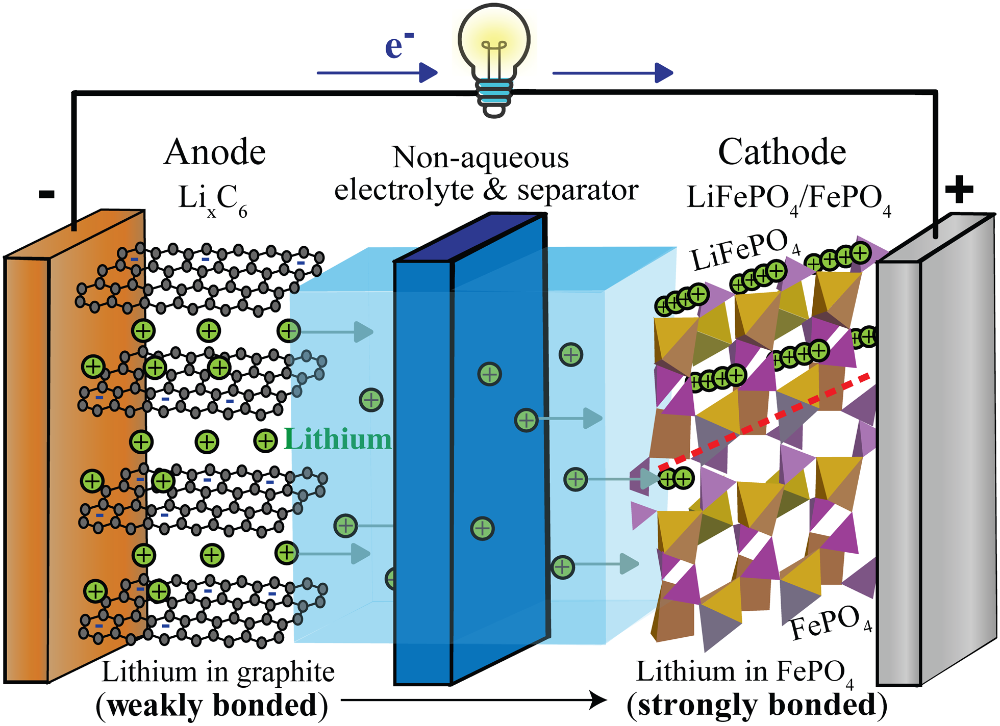

# **Powering Spacecraft: How Advanced Battery Technology Could Transform Small Satellites**
---
### Abstract: {#abs}
Current small satellites still rely on high-energy lithium-ion batteries, the same batteries used in consumer electronics. lithium ions has to travel through a liquid electrolyte when charging and discharing [(Finkelstein et al., 2024)](https://doi.org/10.1039/d4cp00818a), this is inifficient and reduces the amount of charge a battery could store. This article would discuss how potentually using new approches to powering small satellites using Solid State, Sodium-Ion and other advanced batteries could change how small satellites are made. Method. findings.

### Introduction: {#intro}
At a simple level lithium-ion batteries releases or stores charge through a chemical process of moving lithium ions back and forth through a liquid electrolyte, when a lithium atom gets realeased from the anode so does an electron, this electron can't pass through the electrolye so it's forced through a wire to reach the cathode. The lithium ion passes through the electroyle to the cathode terminal and regains that electron. The reverse happens when charging. [(Finkelstein et al., 2024)](https://doi.org/10.1039/d4cp00818a)

<figure>
<strong>Figure 1.</strong>
    
    <figcaption style="font-size: 10pt;">Schematic of a discharging lithium-ion battery.
Source: Finkelstein et al., 2024, Physical Chemistry Chemical Physics, published by the Royal Society of Chemistry, licensed under CC BY 4.0</figcaption>
</figure>

#### Disadvantages to lithium-ion batteries:
 - These batteries if damaged, overcharged, short-circuited, or exposed to excessive heat can catch fire and may explode.
 - limited lifespan...
 - sensitive to temp...

 ### Reference list: {#ref}
 ---
 Finkelstein, S.H. et al. (2024) “How lithium-ion batteries work conceptually: Thermodynamics of Li bonding in idealized electrodes,” Physical Chemistry Chemical Physics, 26(36), pp. 24157–24171. Available at: https://doi.org/10.1039/d4cp00818a.
