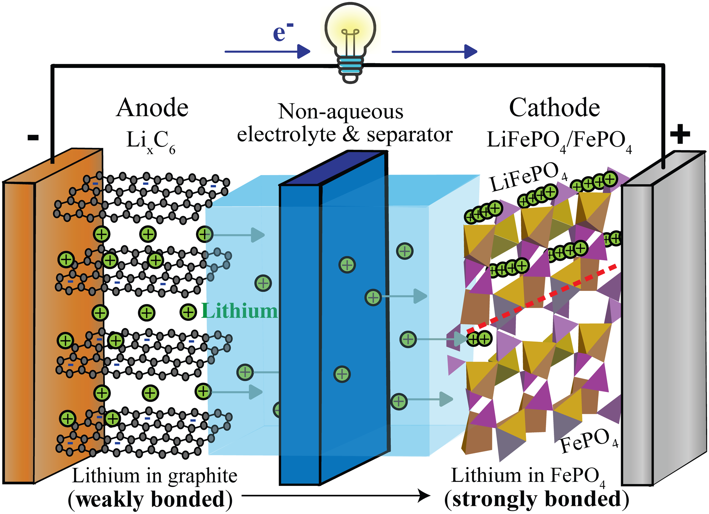
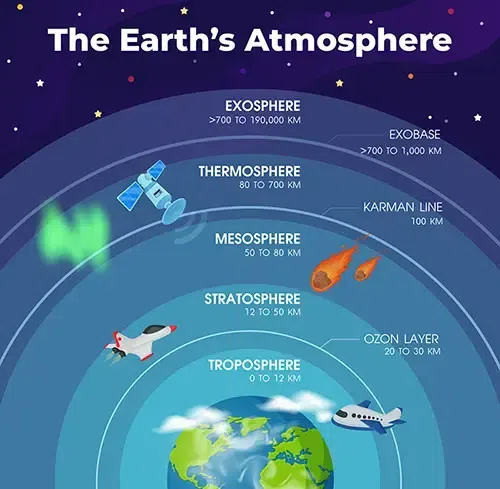

[# **Powering Spacecraft: How Advanced Battery Technology Could Transform Small Satellites**]: #
[# **Powering Spacecraft: Analysis of Advanced Battery Technologies for Small Satellites**]: # 
# **Powering Spacecraft: Batteries that may potentially be used in future small satellites**
---
### Abstract: {#abstract}
Current small satellites still rely on high-energy lithium-ion batteries, the same batteries used in consumer electronics. lithium ions has to travel through a liquid electrolyte when charging and discharing, see figure 1 [(Finkelstein et al., 2024)](https://doi.org/10.1039/d4cp00818a), this is battery technology is outdated and potentially better batteries are emerging. This article would discuss how potentually using new approches to powering small satellites using Solid State, Sodium-Ion and other advanced batteries could change how small satellites are powered. Method. findings.

### Introduction: {#introduction}
At a simple level lithium-ion batteries releases or stores charge through a chemical process of moving lithium ions back and forth through a liquid electrolyte, when a lithium atom gets realeased from the anode so does an electron, this electron can't pass through the electrolye so it's forced through a wire to reach the cathode. The lithium ion passes through the electroyle to the cathode terminal and regains that electron see figure 1. The reverse happens when charging. [(Finkelstein et al., 2024)](https://doi.org/10.1039/d4cp00818a)

<figure>
    
    <figcaption style="font-size: 10pt;"><strong>Figure 1.</strong> schematic of a discharging lithium-ion battery.
Source: Finkelstein et al., 2024, Physical Chemistry Chemical Physics, published by the Royal Society of Chemistry, licensed under CC BY 4.0</figcaption>
</figure>

#### Disadvantages to lithium-ion batteries:
 - If damaged, overcharged, short-circuited, or exposed to excessive heat can catch fire and may explode (Mikolajczak et al., 2011).
 - Limited lifespan (Arsad et al., 2025)
 - Being outside its operating temperature could result in accererated battery degradation (Arsad et al., 2025)

#### Challenges Small Satellites face in low earth orbit

<figure>
    
    <figcaption style="font-size: 10pt;"><strong>Figure 2.</strong> GeeksforGeeks (2025) Composition of Earth's atmosphere. Available at: https://www.geeksforgeeks.org/social-science/composition-of-earths-atmosphere/.</figcaption>
</figure>

Small satellites tend to orbit in the thermosphere, also known as low earth orbit (Riebeek, H. and Simmon, R., 2009), this part of the atmosphere is can have temperature swings from * to * (refernce), this means satellites must use robus thermal management to keep the electronics and lithium ion batteries within operating temperatures. Using alternative batteries would help increase the margin of error, mitigate the effects of temperature swings on battery capesity and creates a more reliable satellites.

### Potential Battery Alternatives {#potential-battery-alternatives}

These batteries listed below have charateristics that could be very benificial for small satilites, in this section i would look at the pros and cons of each battery to determine if it has the potenial to replace standard lithium ion batteries for small satellites.

- **Soild State Lithium-Ion Batteries**
- **Sodium-Ion Batteries**
- **Lithium-Sulfur Batteries**

    <h4 id="solid-state-lithium-ion-batteries">Soild State Lithium-Ion Batteries</h4>
    
Unlike traditinal lithium ion batteries which relys on flammable liquid electrolyte [(Finkelstein et al., 2024)](https://doi.org/10.1039/d4cp00818a), Soild state lithium ion rely on Solid Garnet-Type Oxides (Takada, 2013), this material is non flammable and Self-extinguishing, meaning when punctured this battery won't catch on fire. This battery can handle 100℃ and below 0℃ (reference). 
    

    <h5>
    Disadvantages:
    </h5>
    

    Solid State Batteries rely on garnet-type oxides as a liquid electryle alteratuve, this material is extremely thin and brittle, so small vibrations or impact could damaing and potenulay render the battery useless. having a solid "electrole" also means that ions flows into and out the material with less effiecny compared to liquid.
    

    <h5>
    Conclusions:
    </h5>
    

    Soild state batteries seem very promosing in terms of safety, but due to its current fragile nature and inificency this battery is unlikey to be seen in spacecraft wihtin a few years, in spacecraft efficency and reliablity matters more than safety, though as battery technoloy progresses these problems may be in the future.
    

#### Sodium-Ion Batteries {#sodium-ion-batteries}
Sodium-Ion batteries work on the same back and forth motion as lithium ion batteries, at a fundimatnal level the difference between lithium ion batteries and sodium ion batteries is the different ions, lithium ion batteries use lithium ions whilst sodium ion batteries use sodium ions (refernce). sodium-ion batteries hold on to its capasity even on sub 0℃, whilst traditional lithium ion batteries suffer significant loss in capasity in low sub 0℃ (reference), they are also more stable in harsh temperatures, less likey to expload or get damaged. lithium ion batteries starts to degrade quickly and may expload if exposed to temperatures outside its operating range.
##### Disadvantages:
Sodium atoms are much bigger that lithium atoms (ref), therefore the batteries maximum capasity per size, also know as energy density is reduced, almost as much as 30%, every extra gram adds to launch cost, therefore using this battery can potenially increase the cost.
##### Conclutions:
This battery could be really useful in some applications for satillites, as the extra weight of the battery may potentially add to the cost, if peformace is pioritied then, this battery could be very useful, the extra tollerances to fluctuating temperatures and the abliity to safely drain to 0V means that the satillites could have a higher error margin - creating a reliable satilite.

    <h4 id="lithium-sulfur-batteries">Lithium-Sulfur Batteries</h4>
    

    Lithium-sulfur batteries work different from traditional lithium ion or sodium-ion batteries, instead of moving ions back and forth through a liquid electrolyte, lithium sulfur batteries use a chemical reaction between lithium ions and sulfur when distarging to produce electrisity, this allows us to create a battery with a significally higher energy to volume, also know as energy density, this also significantly reduces the weight of the battery which also reduced launch costs. 
    

    <h5>
    Disadvantages:
    </h5>
    

    This battery uses a different method compared to lithium ion batteries to store energy, this introduces different problems, due to the way this battery works, there is faster battery degrading, meaning the battery loses the maxiuming charge it can store (ref).
    

    <h5>
    Conclusions:
    </h5>
    

    This battery definitely has the potenuial to change small satillies, weight reduction allows the sattilite to carry more advanced sensors for different missions, the reducion in size also allows the satellite to be physically smaller. As this is a relativity new approach to storing charge, the current problems such as faster degrading need to be fixed before we can see this battery technology being used in comersial small satillites.
    

 ### Conclusion {#conclusion}
 Currently the most viable choice would be sodium-ion batteries as the only drawback is has would be its lower energy density, but that drawback gets outweided by its temperature resistance and its ability to go 0V, due to the fluctuating temperature in the thermosphere region, this creates a very reliale satilite that could surive major temperature fluctiations and the battery won't get damaged if the satilite can't get power for a long time. but lithium sulfur batteries has the ablilty to complety change the industry standard, its low volume/ weight to capasity is significatly higher than lithium ion batteries, if engeneers could fix the fast battery degeradtion, this battery would most likey be peferered over standard lithium ion batteries.s

 ### Reference list: {#reference-list}
 ---
 Riebeek, H. and Simmon, R., 2009. Catalog of earth satellite orbits. NASA Earth Observatory, 4.

 Finkelstein, S.H. et al. (2024) “How lithium-ion batteries work conceptually: Thermodynamics of Li bonding in idealized electrodes,” Physical Chemistry Chemical Physics, 26(36), pp. 24157–24171. Available at: https://doi.org/10.1039/d4cp00818a.

 Mikolajczak, C., Kahn, M., White, K. and Long, R.T. (2011). Lithium-ion batteries hazard and use assessment. SpringerBriefs in Fire. Boston, MA: Springer US. doi:10.1007/978-1-4614-3486-3.

 Arsad, S.R. et al. (2025) “Longevity of lithium-ion batteries in EV applications: Techno-economic and environmental impact considerations toward sustainability,” Journal of Energy Storage, 131, p. 117551. Available at: https://doi.org/10.1016/j.est.2025.117551.

Takada, K. (2013). Progress and prospective of solid-state lithium batteries. The Diamond Jubilee Issue, [online] 61(3), pp.759–770. doi:10.1016/j.actamat.2012.10.034.
